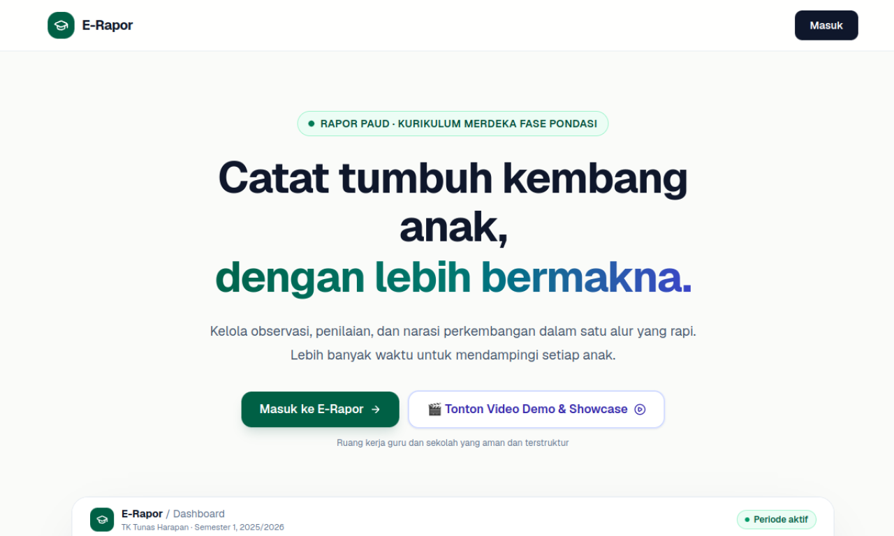

---

## 👋 Tentang Saya

Halo, saya **Umar Faiz Ubaidillah** — software developer yang membangun aplikasi web dan backend dengan **.NET**, **Java**, dan **JavaScript/TypeScript**.

- 🔭 Sedang mengerjakan **E-Raport**, sistem rapor digital (backend Go + frontend TypeScript)
- 🌱 Sedang memperdalam arsitektur backend, REST API, dan database
- 💬 Terbuka untuk diskusi, kolaborasi, dan peluang baru

---

## 🛠️ Tech Stack

### Bahasa & Framework Utama

### Tambahan

---

## 🚀 Project Showcase

### ⭐ Featured: E-Rapor

**Aplikasi rapor digital PAUD (Kurikulum Merdeka Fase Pondasi)** untuk mencatat observasi, penilaian, dan narasi perkembangan anak.

### 📁 Project Lainnya

| Project | Deskripsi | Stack |
| --- | --- | --- |
| [expres-sequelize-postgree](https://github.com/ufaiz50/expres-sequelize-postgree) | REST API dengan Express, Sequelize, PostgreSQL | TypeScript, Node.js |
| [spring-dasar](https://github.com/ufaiz50/spring-dasar) | Latihan dasar Spring | Java |
| [BasicApi](https://github.com/ufaiz50/BasicApi) | Web API dasar | C# / .NET |
| [MCC52ProjectTimeLineManagement](https://github.com/ufaiz50/MCC52ProjectTimeLineManagement) | Aplikasi manajemen timeline project | C# / .NET |
| [portfolio](https://github.com/ufaiz50/portfolio) | Website portofolio | JavaScript |

---

## 📊 Developer Stats

---

## 📫 Kontak

